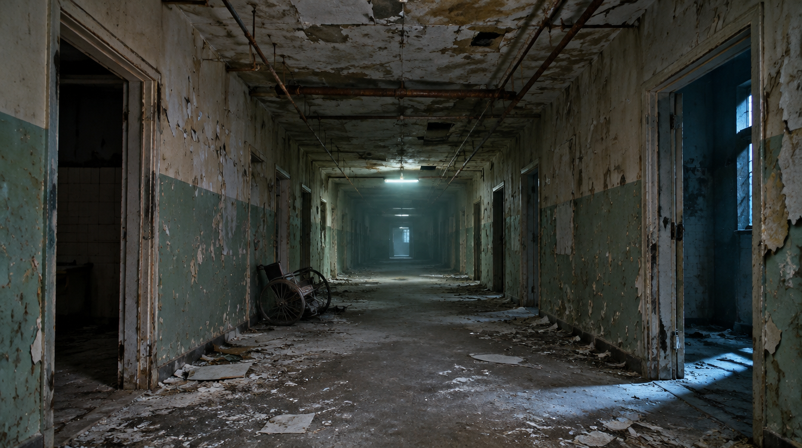

# Head-Tracked Window

A web page that turns your screen into a window. Behind the glass is a 3D haunted corridor; move your head (webcam) or your mouse and the view shifts the way it would through a real window: near door frames slide across far ones, and the far end of the hall barely moves.

**Live demo: <https://walidriachy.github.io/head-tracked-window/>** (the 66 MB scene takes a few seconds to load; use a desktop browser)



It is one HTML file, no build step, no backend.

## Run it

The page must be served over `http://localhost` (or HTTPS), because browsers only allow webcam access on secure origins.

```bash
python3 -m http.server 4173
```

Then open <http://localhost:4173> in Chrome, Edge or Safari.

- Move the mouse to look around.
- Click **Enable head tracking** and allow the camera to drive it with your head instead.
- The scene file is 66 MB, so the corridor takes a few seconds to appear.

| Key | Action |
| --- | --- |
| `I` | Flip left/right, if the motion feels backwards |
| `S` | Switch between the corridor splat and a simple box room |
| `D` | Show the window rectangle (debug) |
| drop a file | Drop any `.spz`, `.ply`, `.splat` or `.sog` file on the page to load your own scene |

You can also load a scene by URL: `http://localhost:4173/?splat=https://example.com/scene.spz`, or start in the box room with `?scene=room`.

## How it works

There are four parts. Each one is small; the effect comes from combining them.

### 1. The scene is a Gaussian splat, not a video or a photo

A Gaussian splat is a 3D capture made of millions of soft, coloured blobs. Unlike a photo with a blur or a tilt effect, it has real depth, so the view can be re-rendered from a different position.

The corridor here has about 1.18 million splats and was made from **a single image**:

1. One wide-angle "abandoned asylum corridor" photo was generated with an image model (`assets/corridor.png`).
2. Apple's [SHARP](https://github.com/apple/ml-sharp) model converted that one photo into a splat (`assets/corridor.ply`).

It is drawn with [three.js](https://threejs.org) and the [Spark](https://sparkjs.dev) splat renderer, both loaded from a CDN.

### 2. The camera is an off-axis ("window") projection

This is the trick that makes it feel like a window rather than a 3D viewer.

A normal 3D camera rotates or orbits when you move. Here the camera never rotates. Instead:

- The screen is treated as a fixed rectangle in the 3D world (the "glass"), at `z = 0`.
- The camera is placed at your eye position in front of it.
- The view frustum is skewed so that its four edges always pass through the four edges of that rectangle.

```js
function setWindowCamera(ex, ey, ez) {            // eye position
  const n = near, d = ez;
  const l = n * (-halfW - ex) / d, r = n * (halfW - ex) / d;
  const b = n * (-halfH - ey) / d, t = n * (halfH - ey) / d;
  camera.position.set(ex, ey, d);
  camera.quaternion.identity();
  camera.projectionMatrix.makePerspective(l, r, t, b, n, far);
}
```

The result: anything at the glass stays pinned to the screen, things behind it shift more the deeper they are, and leaning in widens the view. That is exactly what a real window does.

### 3. Head tracking with the webcam

[MediaPipe Face Landmarker](https://ai.google.dev/edge/mediapipe/solutions/vision/face_landmarker) runs in the browser and finds your face in the webcam image. Only three points are used:

- the **nose tip** gives left/right and up/down,
- the **distance between the outer eye corners** gives how close you are (bigger gap = closer).

The video never leaves your machine; the model runs locally in WebAssembly.

### 4. Smoothing

Raw face tracking jitters, and a jittering camera ruins the illusion. The head position goes through:

- a **One Euro filter**, which smooths heavily when you are still and lightly when you move fast, so it is steady without feeling laggy;
- a **200 ms hold** when the face is lost, followed by an ease back to the mouse position, so the view never snaps.

Without a camera, the mouse drives the same eye position.

## Performance

Splats are expensive per pixel. On a Retina display, rendering at the native 2x resolution ran at about 30 fps; rendering at 1x runs at 60 fps with little visible loss, because splats are soft to begin with. This is the `pixelRatio` setting.

## Settings

All tuning values are in the `cfg` object at the top of the script in `index.html`.

| Setting | What it does |
| --- | --- |
| `strengthX`, `strengthY` | How far the eye travels for a given head or mouse move |
| `depthStrength` | How much leaning in and out changes the view |
| `splat.strength` | Extra travel limit for single-photo splats (see limits below) |
| `splat.pixelRatio` | Render scale, 1 to 2. Higher is sharper and slower |
| `splat.overscan` | How much of the photo is kept outside the screen as margin |
| `splat.hfov`, `splat.aspect` | Field of view and shape of the source photo |
| `minCutoff`, `beta` | One Euro filter: lower `minCutoff` is smoother, higher `beta` is more responsive |
| `holdMs`, `easeMs`, `mouseMs` | Timing for face loss and mouse follow |

## Using your own scene

- **From one photo:** run it through SHARP (or any single-image-to-splat tool), put the `.ply` in `assets/`, and set `splat.url`, `splat.hfov` and `splat.aspect` to match the photo. Keep `splat.fit` as `'camera'`.
- **From a real scan** (Scaniverse, Polycam, Luma, Postshot): drop the file on the page, or set `splat.url` and `splat.fit: 'bbox'`. Real scans hold up under much larger head movement, so `splat.strength` can go up to 1.

## Limits

- **Small movements only for this scene.** A splat built from one photo has nothing behind the objects it shows. Move too far and door frames smear. Head travel is deliberately limited for that reason.
- **Large file.** `corridor.ply` is 66 MB. For a public website it should be converted to a compressed format such as `.spz` or `.sog`.
- **No phone gyroscope mode.** On phones it falls back to touch/mouse position only.
- **One viewer.** The perspective is correct for the tracked face only.

## Credits

- Inspired by Dominik Fojcik's ["BORING"](https://immersive-website.fojcikdominik.com/) head-tracked window site. No code or assets from that site are used here.
- [three.js](https://threejs.org), [Spark](https://sparkjs.dev), [MediaPipe](https://ai.google.dev/edge/mediapipe/solutions/guide).
- Scene reconstructed with Apple's [SHARP](https://github.com/apple/ml-sharp). Check SHARP's model license before using its output commercially.
